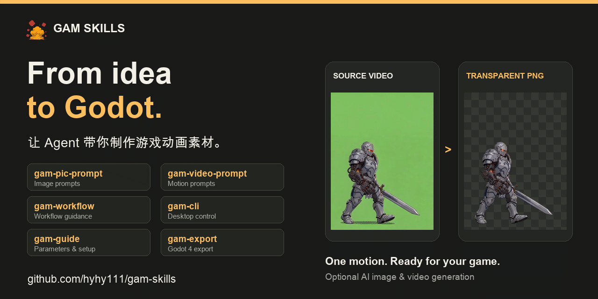

<div align="center">

# Game Assets Maker Skills

**让 Agent 带你制作游戏动画素材。**

**From idea to Godot, with your agent.**

[](#六个-skills怎么选) [](LICENSE) [](gam-export/SKILL.md)

[下载 GAM / Get GAM](https://github.com/hyhy111/game-assets-maker/releases/latest) · [客户端 / Desktop app](https://github.com/hyhy111/game-assets-maker) · [反馈 / Issues](https://github.com/hyhy111/gam-skills/issues)

[中文](#中文) · [English](#english)

</div>



*真实素材处理前后对比，10 FPS 同步循环。 / Actual source and processed frames, looping in sync at 10 FPS.*

## 中文

六个可组合的 Agent Skills，覆盖**角色提示词 → 动作提示词 → GAM 客户端处理 → Godot 4 导入**。可以从创意开始，也可以直接接着已有角色图、视频或 PNG 帧序列继续制作。

Skills 提供指导、客户端操作与导出脚本；抽帧、去背景、对齐和裁剪由 [GAM 桌面应用](https://github.com/hyhy111/game-assets-maker) 完成。**本地处理无需登录或积分，在线 AI 生成按所选服务计费。**

[安装](#一分钟安装) · [选择 Skill](#六个-skills怎么选) · [对话示例](#直接复制开工) · [使用前提](#使用前提与常见问题) · [维护](#开发与维护--development-and-maintenance)

### 一分钟安装

安装工具需要 **Node.js/npm**。选择你的 Agent，安装全部六个 Skills：

```bash
# Codex
npx skills add hyhy111/gam-skills -g -a codex --skill "*"

# Claude Code
npx skills add hyhy111/gam-skills -g -a claude-code --skill "*"

# 自动检测并选择其他 Agent
npx skills add hyhy111/gam-skills -g --skill "*"
```

Cursor、OpenCode、Gemini CLI、GitHub Copilot、Cline 等 Agent 的安装选项见 [Skills CLI 支持列表](https://github.com/vercel-labs/skills#supported-agents)。只写提示词可以直接开始；需要操作客户端时，先[安装并打开 GAM](https://github.com/hyhy111/game-assets-maker/releases/latest)。

### 六个 Skills，怎么选

| 你想做什么 | 使用哪个 Skill | 会得到什么 |
| --- | --- | --- |
| 把角色想法写清楚 | [`gam-pic-prompt`](gam-pic-prompt/SKILL.md) | 明确主体、视角、画风与绿底要求的图片提示词。 |
| 让角色待机、行走、攻击 | [`gam-video-prompt`](gam-video-prompt/SKILL.md) | 继承角色首帧、描述动作与终态的视频提示词。 |
| 从当前素材一路做下去 | [`gam-workflow`](gam-workflow/SKILL.md) | 制作步骤、结果检查、调参建议与下一步交接。 |
| 看不懂参数或配置 | [`gam-guide`](gam-guide/SKILL.md) | 功能说明、处理参数、账号 / Key 与本地数据指引。 |
| 让 Agent 操作 GAM | [`gam-cli`](gam-cli/SKILL.md) | 填写草稿、打开页面、查询任务、执行本地处理与裁剪。 |
| 把最终素材放进 Godot | [`gam-export`](gam-export/SKILL.md) | PNG、逐帧偏移和音效对应的 Godot 4 资源与预览场景。 |

不确定从哪里开始时，直接使用 `gam-workflow`，说明已有素材与想做的动作。

### 直接复制开工

**只有角色想法：**

> 用 gam-pic-prompt，帮我写一个用于侧视游戏的机械骑士图片提示词。手绘卡通风格，单侧机械臂，全身站立，亮绿色背景。

**已有角色图：**

> 用 gam-video-prompt，根据这张角色图写一个原地行走的循环动作提示词。保持角色朝向、装备和画风。

**已有视频：**

> 用 gam-workflow，把我提供的这段绿底视频处理成透明游戏动画帧。先检查素材，再带我完成抽帧、去背景、对齐和裁剪。

**准备 Godot 导入：**

> 用 gam-export，把我提供的裁剪结果目录导入指定的 Godot 4 项目。保留逐帧偏移和已有音效时间线，生成预览场景。

实际使用时提供对应的图片、视频、素材目录或 Godot 项目路径。需要填写客户端草稿时可以继续说“把提示词和参考图填入 GAM 草稿，我检查后手动发送”。

### 从素材到 Godot

| 起点 | 接下来的路径 |
| --- | --- |
| 只有创意 | `gam-pic-prompt` → 角色图 → `gam-video-prompt` → 动作视频。 |
| 已有视频 / GAM 项目 | `gam-workflow` + `gam-cli` → 抽帧、去背景、挖孔对齐 → 裁剪。 |
| 已有 PNG 帧序列 | `gam-export` → Godot 4 动画配置与预览场景。 |

裁剪结果可包含 PNG、`_frame_data.json` 和 `_audio_timeline.json`。导入时保留偏移与音频文件，避免逐帧紧致裁剪后出现抖动或丢失音效。普通统一画布 PNG 序列也可导入；缺少 FPS 信息时先确定播放速度。

Godot 输出包括 `Resources/Animations/<prefix>/` 下的动画配置、`Scenes/Animator/<prefix>.tscn` 预览场景，以及配套播放脚本。详见 [`gam-export`](gam-export/SKILL.md)。

### 使用前提与常见问题

| 场景 | 需要准备什么 |
| --- | --- |
| 提示词与操作指导 | 安装 Skills 的 Agent；只写提示词不要求启动 GAM。 |
| 客户端操作与本地处理 | 安装并打开 GAM，允许 Agent 访问本地文件和执行命令；首次去背景按应用提示下载模型。 |
| Godot 4 导入 | Python **3.10+**、素材目录与 Godot 4 项目。导出脚本只依赖 Python 标准库，Agent 可先检查环境。 |
| 在线 AI 生成 | 在 GAM 配置 ForFuner AI 账号或自定义 Key；填写草稿与提交生成分开，生成前检查当前费用。 |

- **本地素材背景**：当前 GAM 去背流程针对均匀、纯色亮绿背景优化；非绿底效果需要检查，主体中的近似绿色也可能被移除。
- **CLI 入口**：安装版 GAM 启动后注册 macOS 的 `~/.gam/gam-agent`，或 Windows 的 `%USERPROFILE%\.gam\gam-agent.cmd`。设置 `GAM_DATA_ROOT` 时使用该目录；Agent 应核对 CLI 与应用的数据目录一致。
- **付费生成**：准备提示词或填写草稿不会自动创建生成任务。直接提交需遵循客户端开关和当前对话授权；查询任务、本地处理与 Godot 导出不依赖这个生成开关。
- **遇到问题**：客户端安装与处理问题见 [GAM 使用说明](https://github.com/hyhy111/game-assets-maker#使用说明)；Skill 指导、CLI 衔接和导出脚本问题请提交 [Issue](https://github.com/hyhy111/gam-skills/issues)，附 Skill 名、Agent、应用版本、系统与脱敏错误信息。

## English

Six composable agent skills for **character prompts → motion prompts → GAM desktop processing → Godot 4 import**. Start from an idea, a character image, a video, or an existing PNG animation sequence.

Skills provide guidance, client operations, and an export script. The [GAM desktop app](https://github.com/hyhy111/game-assets-maker) performs frame extraction, background removal, alignment, and trimming. **Local processing requires no login or credits; online AI generation is billed by the selected service.**

### Install

The installer requires **Node.js/npm**. Choose the command for your agent to install all six skills:

```bash
# Codex
npx skills add hyhy111/gam-skills -g -a codex --skill "*"

# Claude Code
npx skills add hyhy111/gam-skills -g -a claude-code --skill "*"

# Detect and choose another agent
npx skills add hyhy111/gam-skills -g --skill "*"
```

See the [Skills CLI supported agents](https://github.com/vercel-labs/skills#supported-agents) for Cursor, OpenCode, Gemini CLI, GitHub Copilot, Cline, and others. [Install and open GAM](https://github.com/hyhy111/game-assets-maker/releases/latest) before client operations.

### Choose a skill

| Skill | Use it for |
| --- | --- |
| [`gam-pic-prompt`](gam-pic-prompt/SKILL.md) | Character image prompts with a clear viewpoint, style, and green background. |
| [`gam-video-prompt`](gam-video-prompt/SKILL.md) | Idle, walk, attack, and other motion prompts based on a character frame. |
| [`gam-workflow`](gam-workflow/SKILL.md) | Step-by-step production, result inspection, adjustments, and handoff. |
| [`gam-guide`](gam-guide/SKILL.md) | Features, processing parameters, account / key setup, and data locations. |
| [`gam-cli`](gam-cli/SKILL.md) | Draft editing, navigation, task queries, local processing, and trimming. |
| [`gam-export`](gam-export/SKILL.md) | Importing PNG frames, trim offsets, and audio into Godot 4 resources and a preview scene. |

Start with `gam-workflow` if you are unsure which skill to use.

### Try it

> Use gam-pic-prompt to write an image prompt for a side-view mechanical knight with one robotic arm. Hand-drawn cartoon style, full-body standing pose, bright green background.

> Use gam-workflow to turn my green-background video into transparent animation frames. Inspect it first, then guide extraction, background removal, alignment, and trimming.

> Use gam-export to import my trimmed animation directory into my Godot 4 project. Preserve frame offsets and the existing audio timeline, and create a preview scene.

Provide the actual reference image, video, asset directory, or Godot project path. To prepare a generation draft, ask the agent to fill it in GAM, review it, and send it manually.

### Requirements and output

- **Prompts**: an agent with the skills installed; GAM does not need to be running just to write a prompt.
- **Client operations**: an installed, running GAM app and permission for local commands / file access. Download the background-removal model when the app prompts. The current workflow is optimized for a uniform bright green background.
- **Godot export**: Python **3.10+** using only its standard library, an asset directory, and a Godot 4 project. The agent can check the Python environment first. Plain PNG sequences work too; retain `_frame_data.json`, `_audio_timeline.json`, and audio files when present.
- **AI generation**: use the account or custom key configured in GAM. Preparing a draft does not submit a generation task; direct submission follows the app switch and conversation authorization.

Stable CLI entries are `~/.gam/gam-agent` on macOS and `%USERPROFILE%\.gam\gam-agent.cmd` on Windows after launching the installed app. `GAM_DATA_ROOT` overrides the directory. Keep the client and CLI data roots consistent.

Godot output includes animation configs in `Resources/Animations/<prefix>/`, a `Scenes/Animator/<prefix>.tscn` preview scene, and playback support scripts. See [`gam-export`](gam-export/SKILL.md) for details.

For app installation and processing, see the [GAM guide](https://github.com/hyhy111/game-assets-maker#usage). For skill or exporter issues, [open an issue](https://github.com/hyhy111/gam-skills/issues) with your skill, agent, app version, OS, and redacted error details.

## 开发与维护 / Development and maintenance

本仓库独立维护，也作为客户端的 `.agents/skills` 子模块使用。目录中直接包含六个 `gam-*` Skill，其脚本、参考资料与 Godot 资源随 Skill 一起分发。

This repository is maintained independently and checked out at the client's `.agents/skills` submodule path. Supporting scripts, references, and Godot assets ship with their skills.

```bash
# Clone the client with Skills / 克隆客户端并获取 Skills
git clone --recurse-submodules https://github.com/hyhy111/game-assets-maker.git

# Initialize the recorded revision / 初始化主仓库记录的版本
git submodule update --init -- .agents/skills

# Validate changes to Godot export / 修改导出行为后的检查
python3 gam-export/tests/test_generate.py
```

最后一条命令从 Skills 仓库根目录运行。修改前阅读 [AGENTS.md](AGENTS.md) 及相关 Skill。先在子仓库验证、提交并推送所需内容，再回到客户端更新子模块指针；两个仓库分别提交。已有改动需保留，其他本地 Skills 保持忽略，不使用 `git add .` 混入无关文件。

Run the export check from the Skills repository root. Read [AGENTS.md](AGENTS.md) and the relevant skill before editing. Validate, commit, and push Skills separately before updating the client's submodule pointer. Preserve pending changes and keep unrelated local skills ignored; stage explicit paths.

---

[MIT](LICENSE) © ForFuner
